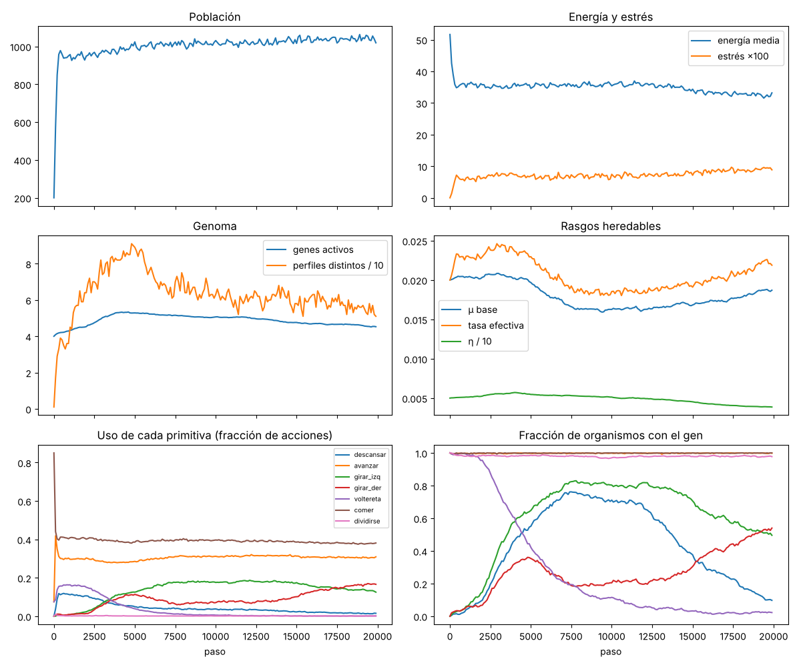
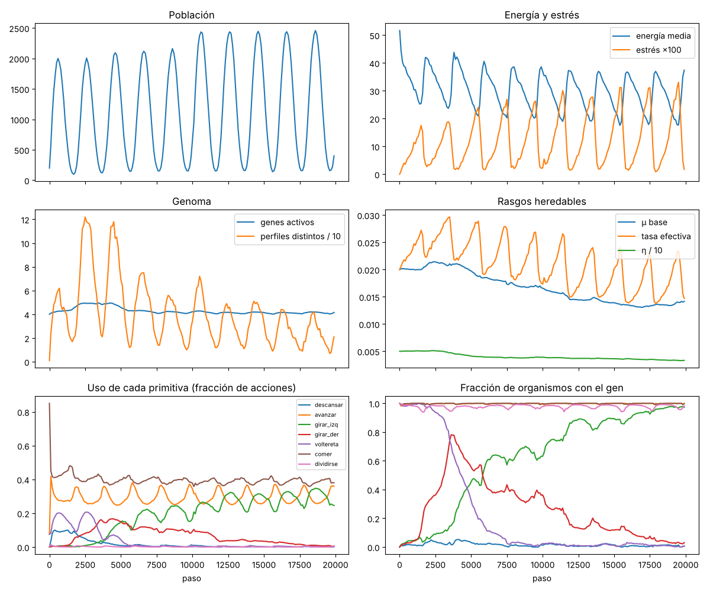

# 2026-10-23 · Fase 1: evaluación de criterios y experimentos exploratorios

## Preguntas
1. ¿La base funciona? Es decir, ¿la población persiste, se adapta, es reproducible y alcanza un rendimiento aceptable? (criterios C1–C4)
2. Exploratorio: ¿qué aportan la mutación, el aprendizaje y la mutagénesis por estrés?

## Configuración
- Código: commit con las correcciones de la revisión independiente (estrés basado en hambre, control barajado, muerte antes de actuar).
- `experiments/configs/base.toml`: mundo de 128×128, entorno constante en parches, 200 LUCA iniciales.
- `experiments/configs/variable.toml`: igual a la base, más estaciones (amplitud 0,6, período 2000) y un cambio abrupto del mapa en el paso 10 000.
- 20 000 pasos y semillas 1 a 5 por condición. Competencias: 3000 pasos sin mutación, en un mapa distinto del de la evolución.
- Duración: 33 minutos con 4 procesos.

Para reproducirlo:
```bash
python experiments/fase1/evaluar.py --salida runs/fase1 --procesos 4 --pasos 20000 --semillas 5
```
El informe completo está en [`2026-10-23-fase1-informe.json`](2026-10-23-fase1-informe.json).

## Criterios de éxito: los cuatro aprobados

| Criterio | Umbral | Resultado |
|---|---|---|
| C1 Persistencia | ≥ 4 de 5 semillas sobreviven 20 000 pasos | **5/5** ✅ |
| C2 Adaptación | evolucionados > 80 % frente a LUCA en ≥ 4 de 5 | **100 %, 100 %, 100 %, 100 %, 99,8 %** ✅ |
| C3 Reproducibilidad | misma huella (métricas + estado completo) en dos procesos | **idéntica** ✅ |
| C4 Rendimiento | ≥ 50 pasos/s con ~1500 organismos | **50,0 pasos/s con 1815** ✅ (justo en el límite) |

## Observado

### 1. La evolución inventó una conducta que LUCA no tenía
LUCA no tiene genes de giro: se reorienta con volteretas al azar. En **las 15 corridas revisadas** (base, variable y sin aprendizaje, 5 semillas cada una) aparecieron genes de giro por mutación (cambio de primitiva o gen nuevo), se extendieron y **la voltereta dejó de usarse** (uso final: 0 %). Los giros pasaron a ocupar entre el 20 % y el 36 % de las acciones.

Además, cada población **se lateralizó**: casi todos sus organismos giran hacia un solo lado, y el lado depende de la semilla (por ejemplo, en la base, la semilla 5 tiene 100 % de giro a la derecha; en sin aprendizaje, la semilla 4 tiene 100 % a la izquierda). Es una ruptura de simetría: las dos opciones son equivalentes, una se fija por azar y después la mantiene la herencia.



### 2. Efectos medidos (comparación pareada: misma semilla, mismo mapa)
Población media de los últimos 5000 pasos, condición contra su control:

| Comparación | Diferencia por semilla | Lectura |
|---|---|---|
| Base contra sin mutación | +7,2, +8,6, +2,9, +6,7, +9,8 % | **La evolución aumenta la capacidad de carga** (5/5) |
| Base contra sin aprendizaje | +5,0, +1,6, +2,5, +10,8, +2,2 % | **El aprendizaje ayuda un poco** (5/5 positivas) |
| Estrés propio contra barajado | +3,4, −3,1, +5,5, +1,1, +5,9 % | Indicio débil (4/5), no concluyente |
| Estrés propio contra sin estrés | +6,4, −3,8, +0,9, +0,4, +2,8 % | No concluyente |

Tras el cambio abrupto, la población mínima fue prácticamente la misma en las tres variantes de estrés: 146 ± 34 (propio), 148 ± 37 (barajado) y 154 ± 34 (sin estrés).

### 3. Rasgos heredables
- **η (aprendizaje)** baja levemente en todas las condiciones (de 0,05 a ~0,042). Aunque el aprendizaje ayuda a la población, la selección no lo favorece a nivel individual en esta escala de tiempo.
- **σ (sensibilidad al estrés)** sube algo en el entorno variable (2,0 → 2,59 ± 0,60) y menos en la base (2,11 ± 0,32), pero también en el control barajado (2,44 ± 1,1). Esa diferencia está dentro del ruido.
- **μ (tasa base)** baja en el entorno variable (0,020 → 0,014). Con estrés, la tasa efectiva oscila con las estaciones (gráfico de abajo): sube en la escasez y baja en la abundancia.
- **El genoma no crece**: se mantiene entre 4,4 y 5,4 genes. El costo por gen y la falta de nuevas oportunidades lo frenan.



## Interpretación (prudente)
- La base está validada: hay herencia, variación y selección, y producen adaptación real y medible. La adaptación se transfiere a un mapa nuevo (C2).
- La aparición del giro es el primer ejemplo de lo que busca el proyecto en pequeño: **una capacidad que no estaba programada en el organismo inicial y que surge del ADN por evolución**. Hay que aclarar que la primitiva "girar" sí existía en la física: lo que emergió es que el organismo la expresara y la integrara en su conducta.
- La mutagénesis por estrés **no mostró un beneficio claro** a esta escala. Es honesto reportarlo así. Posibles razones: pocas generaciones (~45–50 en 20 000 pasos) y una presión del entorno que se resuelve con ajustes finos, no con innovaciones.
- **Limitación principal: pocas generaciones.** Un tiempo generacional de ~400 pasos frena la evolución. Las fases siguientes van a necesitar corridas mucho más largas (equipo local) o una física que acelere el recambio.

## Pendientes y siguientes pasos
- Repetir E1 (estrés) con 20 semillas y 100 000 pasos en el equipo local, para decidir si el efecto existe.
- El rendimiento está en el límite (50 pasos/s): optimizar o migrar el núcleo antes de la fase 2.
- Fase 2: primitivas de asociación (unirse, compartir energía) y transferencia horizontal de genes.
