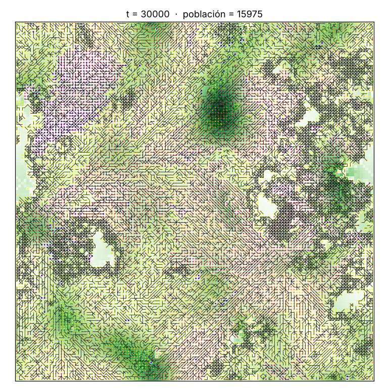
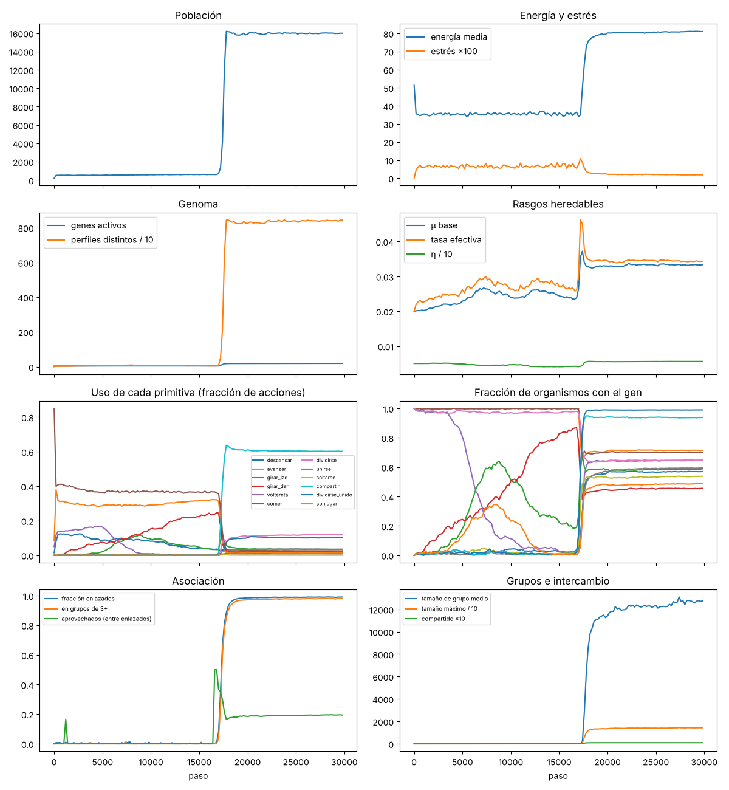

# 2026-10-23 · Fase 2: asociación, evaluación de criterios y exploración

## Preguntas
1. ¿La mecánica de asociación es correcta, reproducible y suficientemente rápida? (criterios C1–C4)
2. Exploratorio: con la posibilidad física de asociarse (unirse, soltarse, compartir, dividirse unido, conjugar), ¿la evolución la aprovecha? ¿Bajo qué condiciones?

## Configuración
- Código: commit con las correcciones de la revisión científica (movimiento de grupo, adhesión sin costo oculto, clon orientado como su progenitor, compartir antes de comer, aprendizaje sin la energía recibida, controles inerte y positivo).
- 30 000 pasos y semillas 1 a 5 por condición. LUCA **no tiene genes de asociación**: si aparecen, es por mutación.
- Duración: 101 minutos con 4 procesos.

| Condición | Qué cambia |
|---|---|
| `base` | entorno constante, adhesión activada |
| `variable` | estaciones (amplitud 0,6) |
| `base_elastico` | sin adhesión: el enlace se rompe si se separan |
| `base_sin_beneficio` | compartir con eficiencia 0 (solo destruye energía) |
| `base_inerte` | las primitivas existen y cuestan, pero no hacen nada |
| `base_positivo` | **control positivo**: compartir con eficiencia 2 (crea energía) |

Para reproducirlo:
```bash
python experiments/fase2/evaluar.py --salida runs/fase2 --procesos 4 --pasos 30000 --semillas 5
```
Informe completo: [`2026-10-23-fase2-informe.json`](2026-10-23-fase2-informe.json).

## Criterios: los cuatro aprobados

| Criterio | Resultado |
|---|---|
| C1 Persistencia con asociación (base y variable) | **5/5 y 5/5** ✅ |
| C2 Invariantes de enlaces (2000 pasos de asociación forzada, 73 102 enlaces revisados) | **0 violaciones** ✅ |
| C3 Reproducibilidad (con asociación forzada) | **huella idéntica** ✅ |
| C4 Rendimiento | **55,7 pasos/s** con 1852 organismos ✅ |

## Observado

### 1. Con la física "natural", la asociación no despega
Medias del último cuarto de cada corrida:

| Condición | Enlazados | En grupos de 3+ | Grupo más grande visto | Con gen de compartir | Con gen de dividirse unido |
|---|---|---|---|---|---|
| base | 0,14 % | 0,03 % | 4–8 | 2,0 % | 0,4 % |
| variable | 0,25 % | 0,09 % | 9 | 0,9 % | 1,0 % |
| sin beneficio | 0,13 % | 0,03 % | 4–7 | 0,9 % | 0,5 % |
| elástico | 0,22 % | 0 % | 2–4 | 0,9 % | 21 % |
| inerte | 0 % | 0 % | 1 | 1,3 % | 39 % |

- `base` y `sin_beneficio` son **indistinguibles**: con la física actual, compartir energía no da ninguna ventaja detectable. Los genes de asociación se mantienen en el 1–2 % que produce la mutación (balance mutación-selección).
- **La adhesión tiene costo y la selección lo purga.** El gen de dividirse unido llega al 39 % en `inerte` (donde equivale a una división común y deriva sin costo) y al 21 % en `elástico` (el enlace se rompe enseguida, así que es casi neutro), pero solo al 0,4 % en `base`. Quedar pegado sin coordinación perjudica.
- **Los enlaces son entre parientes:** la distancia de etiqueta entre enlazados (0,07) es menos de la mitad que entre pares al azar (0,18), coherente con que casi todos los enlaces nacen de divisiones unidas (grupos clonales).

### 2. Control positivo: cuando asociarse rinde, ocurre una transición abrupta
En **2 de 5 semillas** (3 y 5), la población pasó de casi 0 % a **más del 98 % de organismos enlazados** en unos 800 pasos:

| Semilla 5 | Paso 16 600 | 17 000 | 17 400 | 17 800 | 18 200 |
|---|---|---|---|---|---|
| Población | 599 | 713 | 4144 | 16 204 | 16 133 |
| Enlazados | 0,3 % | 8 % | 66 % | 88 % | 95 % |
| Grupo más grande | 2 | 11 | 802 | 10 099 | 12 592 |

- El disparador es la **combinación** de dos genes en un mismo linaje: dividirse unido y compartir. Ambos pasan juntos de ~1 % a más del 95 %.
- Aparece un **tapete** que cubre casi todo el mundo (un grupo conexo de 10 000 a 14 000 organismos).
- **Aparecen aprovechados:** entre el 19 % y el 27 % de los enlazados reciben mucho más de lo que dan. El conflicto que predice la hipótesis aparece solo, sin programarlo.
- En las otras 3 semillas la combinación no surgió en 30 000 pasos. **El cuello de botella es el descubrimiento:** la ventaja existe desde el principio, pero hay que dar con la combinación correcta de genes.
- Aclaración: con eficiencia 2, compartir **crea energía**; la población de 16 000 es un artefacto de esa energía gratuita. Este control no muestra una biología plausible: muestra que **el protocolo detecta la asociación cuando conviene**, y que la física permite organizaciones de miles de individuos.




## Interpretación (prudente)
- La mecánica de asociación funciona y permite formar organizaciones grandes; la medición las detecta.
- Con la física actual, **asociarse no rinde**. Sus únicos beneficios físicos son llevar energía a un socio sin recurso y repartir el riesgo de morir, y no compensan los costos (mantener enlaces, perder movilidad sin coordinación). Es un resultado limpio gracias a los controles: no lo explica un bug (revisión), ni la falta de detección (control positivo), ni el espectro mutacional (inerte).
- Esto concuerda con la biología: la multicelularidad no surge por poder pegarse, sino donde el grupo obtiene algo que el individuo no puede, como digestión externa compartida, escape de depredadores por tamaño, dispersión o división del trabajo.
- La transición abrupta del control positivo se parece a lo que se espera de una **transición mayor**: rara, repentina y con conflicto interno inmediato.

## Siguiente paso propuesto
Una fase dedicada a la **pregunta central de la hipótesis**: ¿qué condiciones ecológicas, impuestas como física del mundo y no como premio a la asociación, hacen que asociarse rinda? Candidatas, de menor a mayor complejidad:
1. **Recurso complejo**: alimento cuyo rendimiento crece con la cantidad de organismos que lo procesan juntos (análogo a las enzimas extracelulares, un bien público).
2. **Depredación o peligro** que afecta menos a los grupos grandes.
3. **Dispersión**: parches efímeros que solo puede alcanzar un grupo que se mueve coordinado.

Además, conviene acortar el tiempo de descubrimiento: más semillas y corridas más largas en GPU, con el núcleo ya preparado para detectarla.
