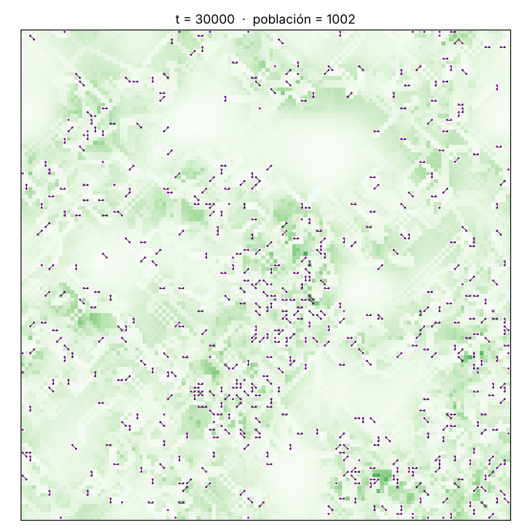
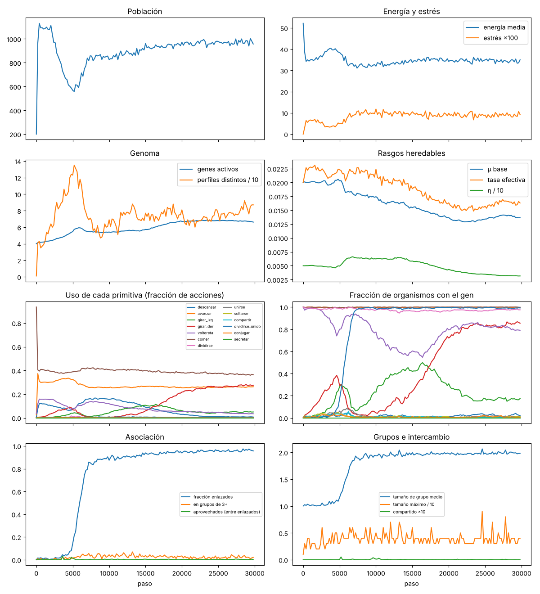

# 2026-10-24 · Fase 2c: depredación limitada por tamaño, resultados

Hipótesis y reglas prerregistradas en [`2026-10-23-fase2c-prerregistro.md`](2026-10-23-fase2c-prerregistro.md) (versión 2 y addendum). Las hipótesis las evalúa el propio script (`experiments/fase2c/evaluar.py`, `evaluar_hipotesis`). Esta bitácora fue **corregida tras una revisión científica de la interpretación**: la versión anterior exageraba varias afirmaciones (ver "Correcciones" al final).

## Configuración
- `experiments/configs/depredacion.toml`: física base con asociación y movimiento de grupos por empuje.
- Depredador: ataque con probabilidad 0,015 por organismo y paso. El ataque mata con probabilidad 1 − (tamaño − 1)/(refugio − 1), con refugio 2: los sueltos mueren y los grupos de 2 o más quedan a salvo. Aclimatación de 2000 pasos.
- **Núcleo** (aparición brusca): semillas 11–20. Informe: [`2026-10-24-fase2c-nucleo-informe.json`](2026-10-24-fase2c-nucleo-informe.json).
- **Rampa** (la intensidad sube durante 8000 pasos): semillas 31–40. Informe: [`2026-10-24-fase2c-rampa-informe.json`](2026-10-24-fase2c-rampa-informe.json).
  - El valor 8000 se eligió sin pilotos y no se probó ningún otro.
  - El C1 de ese informe dice "0/10" por un error del script, ya corregido: contaba solo la condición `refugio`, que no se corrió en la rampa. El dato correcto es 10/10.
- **Variantes probadas en total en esta fase**, para dimensionar el riesgo de buscar hasta encontrar:
  - intensidades 0,002 / 0,005 / 0,01 / 0,015 / 0,02 en pilotos de 2 semillas;
  - refugios 2, 3 y 4, abrupto y gradual;
  - la versión 1 (anulada), la versión 2 (núcleo) y la rampa.

  Con 0,02 todo se extingue y con 0,01 o menos no hay efecto: **la ventana de intensidades viable es angosta**.
- Pendiente: semillas 21–30 en el equipo local (barrido de dosis P4, refugio 3 y sin división unida).

## Criterios
- C1: núcleo 6/10, ❌; rampa 10/10, ✅.
- C2, invariantes de enlaces: 0 violaciones en 415 000 enlaces revisados. ✅ El chequeo "nadie en un grupo refugio muere por ataque" es una prueba de código: con refugio 2 se cumple por construcción.
- C3, reproducibilidad: ✅. La prueba original no alcanzaba al depredador (corría 1500 pasos con el depredador desde el paso 2000). Se corrigió para que actúe dentro de la prueba, y el determinismo también se verificó aparte.
- C4: 70 pasos/s con 1394 organismos. ✅

## Hipótesis

| # | Estatus | Resultado |
|---|---|---|
| **P1** | Prerregistrada (versión 2) | ❌ **No cumplida.** Sobreviven 6/10; > 0,5 en refugio en 4 de 6 (0,45 / 0,08 / 0,79 / 0,75 / 0,65 / 0,52). Falla en parte por extinciones (4/10) y en parte por sobrevivientes poco asociadas (2/6). |
| P2 | Prerregistrada | ✅ Depredador uniforme: ~0,1 % en refugio (4/4 sobrevivientes en el núcleo; 10/10 en la rampa). |
| P3 | Prerregistrada | ✅ Protección aleatoria: ~0,2 % (10/10 en ambos). Lectura acotada: ver el punto 2 abajo. |
| **P1-rampa** | **Hipótesis nueva**, formulada después de que P1 fallara, prerregistrada antes de correr y con semillas nuevas | ✅ Sobreviven 10/10; > 0,5 en 9/10. Media 0,77; rango 0,35–0,96; población entre 247 y 1099. |
| P4 | Prerregistrada | ⏳ Pendiente (semillas 21–30). Sin P4 la fase no se archiva. |

Con 9/10, el intervalo de confianza binomial aproximado es 55–99,7 %, así que hay poco margen sobre la regla del 80 %. En cambio, el contraste con los controles (0,77 contra 0,001–0,002, pareado con los mismos sorteos del depredador) no tiene problema de ruido.

## Lo que muestran los datos
1. **Con un depredador limitado por tamaño que aparece gradualmente, a intensidad 0,015, la asociación evoluciona sola desde LUCA** (P1-rampa). Es la primera condición del proyecto en la que asociarse se impone. La robustez a la dosis (P4) y al valor de la rampa no está probada todavía, y con aparición brusca la prueba prerregistrada falló.
2. **Lo que se puede afirmar sobre la causa.** La protección tiene que **depender de estar unido**:
   - la mortalidad alta por sí sola no basta: el depredador uniforme, con la misma tasa de ataque y los mismos sorteos, no produce grupos (P2);
   - una protección que no depende de los enlaces tampoco: el control aleatorio no produce grupos (P3).
   
   **El control aleatorio no iguala la protección.** Mientras se decide la selección, `refugio` sufre una depredación parecida a la de `uniforme`, y mucho mayor que la de `aleatorio`. Muertes por depredación por cada mil organismos-paso (rampa, 10 semillas):

   | Pasos | refugio | aleatorio | uniforme |
   |---|---|---|---|
   | 2000–6000 | 2,8–3,4 | 0,36–0,38 | 3,1–3,5 |
   | 6000–10 000 | 1,6–10,7 | 1,1 | 11,0–11,6 |
   | 22 500–30 000 | 0,6–9,9 (mediana ~3,7) | 1,5 | ~15 |

   Por eso la población de `aleatorio` (~950) se parece a la de una población sin depredador. Un control que iguale la mortalidad realizada (muertes al azar en la misma cantidad que en `refugio`) queda pendiente.
3. **Los enlazados son parientes cercanos.** La distancia de etiqueta entre enlazados es 0,015, contra 0,12 entre pares al azar, y en 9 de 10 semillas la división unida está en ≥ 99 % de la población. La etiqueta muta de forma independiente del resto del genoma, así que esto indica parentesco reciente, no que sean clones.
4. **Observación exploratoria (1 de 10 semillas):** en la semilla 32, la división unida subió al 50 % (paso 6000) y después cayó al ~1 %, mientras el gen de unirse osciló entre 8 % y 63 % (media 49 % en el último cuarto). La población llegó al 35 % en refugio. Puede ser un camino por **unión activa** en lugar de división unida, pero las métricas no registraban de dónde sale cada enlace. Se agregó un contador y se está verificando.
5. **Los grupos son mayormente pares** (tamaño medio 1,8 en la rampa, con máximos de 6 a 10 y ~5 % en grupos de 3 o más). Con refugio 2, un grupo más grande no protege más.
6. **La transición varía entre semillas.** En la rampa, la fracción de enlazados superó el 50 % entre los pasos 6000 y 21 200. Con aparición brusca, entre 2800 y 4600 en 5 de las sobrevivientes; la semilla 19 recién en el 24 400 y la 15 nunca.

## Interpretación (prudente)
- El resultado es análogo al de Boraas et al. (1998): un depredador limitado por tamaño favorece que las células hijas queden unidas. En la simulación, eso ocurre **con aparición gradual del depredador y en una ventana angosta de intensidades**.
- Lo emergente es **mínimo**: mayormente pares de parientes, sin división del trabajo ni coordinación compleja. Es el **primer escalón** de la transición que plantea la hipótesis. El grupo existe y paga, pero todavía no es un individuo.

## Pendiente antes de archivar
1. P4 (dosis), refugio 3 y sin división unida: semillas 21–30, en el equipo local.
2. Origen de los enlaces en la semilla 32 (en curso).
3. Más adelante: el control de mortalidad igualada y la robustez a otro valor de rampa (prerregistrados con semillas nuevas).

## Correcciones respecto de la primera versión de esta bitácora
- Se afirmaba que el control aleatorio daba "protección de magnitud parecida": es falso (ver la tabla).
- "Dos caminos evolutivos, como en la biología" se rebajó a observación exploratoria de una semilla, y se quitó la analogía con *Volvox* y *Dictyostelium*.
- "Grupos clonales" pasó a "parientes cercanos".
- La rampa se presenta como hipótesis nueva, no como prueba de que P1 fallara solo por las extinciones.
- Se corrigieron números: la transición con aparición brusca no siempre fue entre los pasos 2800 y 4600; el grupo de 19 era del núcleo, no de la rampa; una extinción ocurrió en el paso 7544, no "justo después" de que apareciera el depredador.
